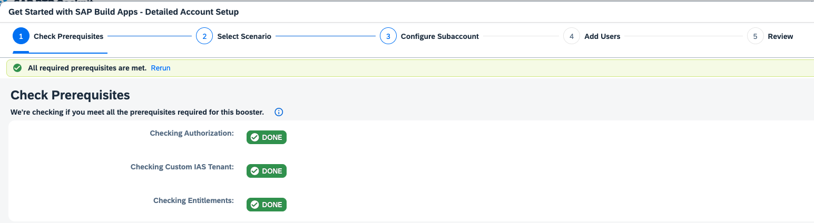
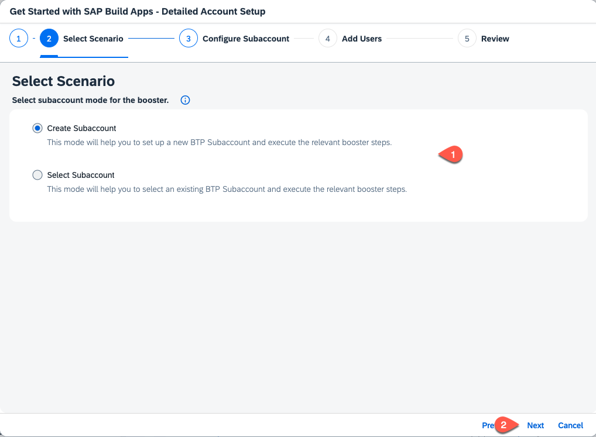
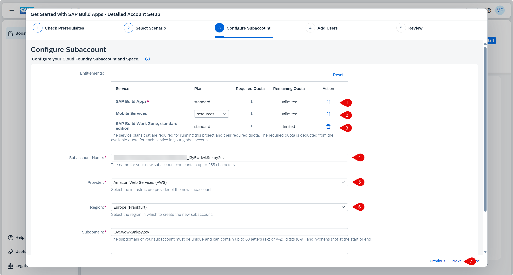
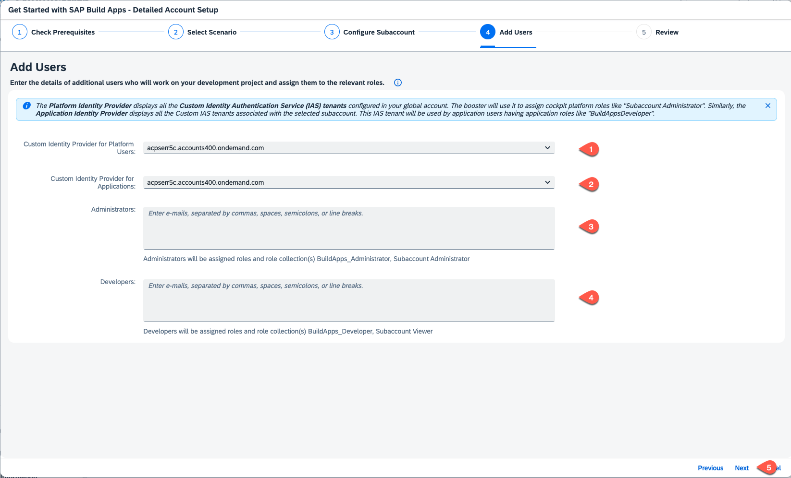

# Setup the SAP Build Apps Service

Use the following steps to set up your account.

## Manual Setup

1. When the prerequisites are checked successfully, press **Next**.

    

2. Select **Create Subaccount** or choose **Select Subaccount** if you want to set up an existing subaccount and press **Next**.

    

3. Set **SAP Build Apps** and **SAP Build Workzone, standard edition**. For testing purpose you can choose the **free** service plan, for productive usage take the **standard** plan. Set **Mobile Services** with the **resources** plan.

   

4. In the section **Custom Identity Provider for Applications**, select the tenant you want to use. Optionally, add additional administrator and developer users, then press **Next**.

    

5.  Check your settings and press **Finish**.

6. Choose **Navigate to subaccount**, which will open the subaccount on another tab. Come back to this tab and press **Close**.

